# Исследование и оптимизация краудфандинговой платформы

Имитационное моделирование DES, ABM, SD и M/M/c/K

## Аннотация

В эталонном DES при 5 проектах/ч доля нарушений SLA модерации равна 19,44 [18,19–20,69]%. Перераспределение каналов R2/R3 до 1/3 стоит 65 условных единиц при 62 в исходной конфигурации. На новой серии из десяти seeds оно дало 0,70 [0,50–0,91]% нарушений и 4,80 [4,77–4,83] выплат/ч. Скобки показывают 95% интервалы по независимым повторам. Применимость результата ограничена учебными параметрами и принятой моделью. Артефакты AnyLogic и подтверждения их запуска описаны в STATUS.md.

## 1. Постановка задачи

Платформа принимает проекты, модерирует, публикует, проводит платежи, обслуживает обращения и споры и выплачивает средства. Восемь ресурсов удовлетворяют спецификации в SPECIFICATION.md. R5 кратковременно обслуживает две разные операции — публикацию и зачисление. Кампания продолжается параллельно с платежами. Парето I с минимумом 500 коп. и формой 2,6 задаёт сумму отдельного платежа. Исходы и единицы выписаны в спецификации. Самостоятельные допущения включают калибровку интенсивности, распределение суммы цели и время обслуживания.

Уравнение (1) задаёт сохранение проектов: поступило = незавершённые + терминальные исходы. Уравнение (2) задаёт учёт копеек: зачислено = удержано + выплачено + возвращено. Прикладное правило остановки использует 2160 ч или 10 000 терминальных исходов. Фиксированный горизонт 2160 ч назначен сравнительным сериям.

## 2. Дискретно-событийная модель

Очередь событий хранит модельное время и стабильный порядок событий. В каждом ресурсе захват и освобождение меняют число занятых каналов. Очередь ограничена, а переполнение имеет явный исход. Платёж может сформировать отдельное обращение и вернуться на одну повторную попытку. После конца сбора расчёт ждёт всех уже зарегистрированных операций и запускает одну выплату. Проверены нулевая нагрузка, сквозной сценарий, перегрузка R3, спор и возвраты, ошибки платежа, недостижимая цель, остановка по счётчику и сброс между повторами. Измерения лежат в results/raw/des_checks.json.

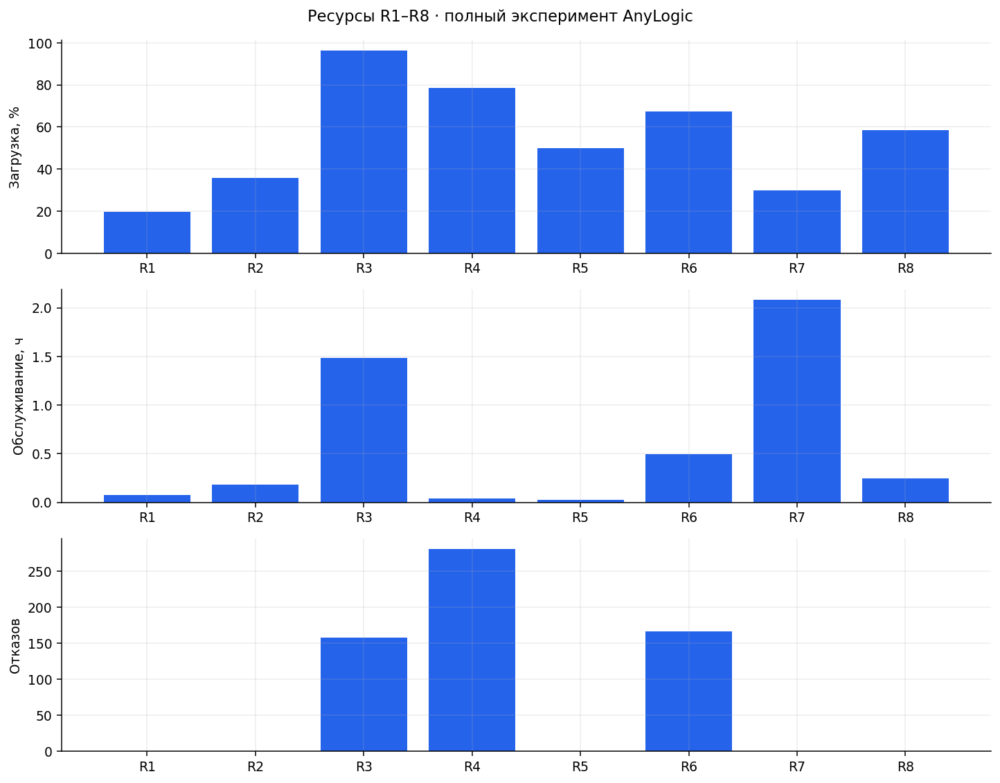

Базовый стохастический прогон AnyLogic PLE 8.9.8 с seed 2501 остановился после 10 000 завершений на 2019,397 ч. Он дал 9590 выплат, 158 технических отказов, 152 461 запись платежа и 17,53% нарушений зрелого SLA модерации. Суммарно зачислено 123 878 914 коп., из которых 122 607 557 выплачено, 855 346 возвращено и 416 011 удержано. Анализ этого прогона и выгрузки R1–R8 приведены в stages/02-des.md. Панель показывает 2D-метрики и изменение очередей в 3D. Отдельные графики времени и гистограммы доступны для каждого ресурса.

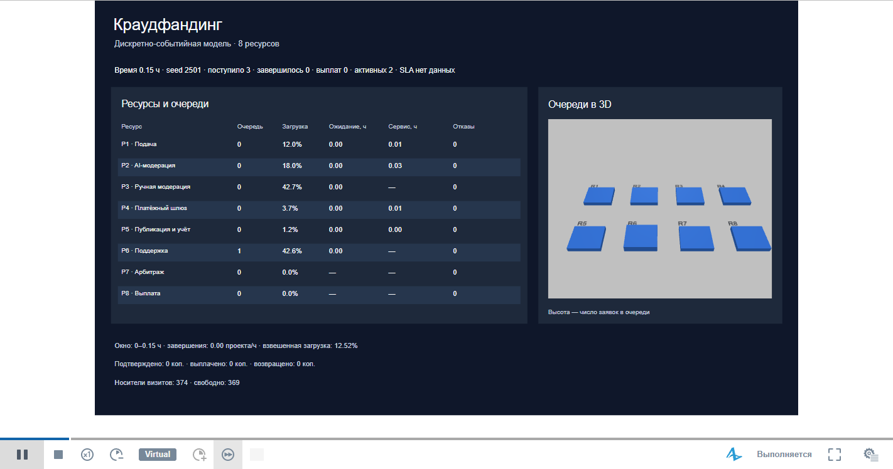

Уравнение (3) задаёт загрузку: интеграл занятых каналов, делённый на интеграл доступной мощности. Среднее число ожидающих равно площади под кривой очереди, делённой на время. Throughput равен числу соответствующих завершений, делённому на окно наблюдения. Общая загрузка взвешена по времени доступности каналов.

## 3. Узкое место, SLA и планирование мощности

В 12 конфигурациях проведено по 10 повторений. По зрелой когорте знаменатель охватывает все проекты с моментом подачи не позже конца окна минус 8 ч. Незавершённые к своему сроку включены в нарушения. Молодые незавершённые участвуют в диапазоне возможных исходов всей когорты. P95 относится к наблюдаемым решениям.

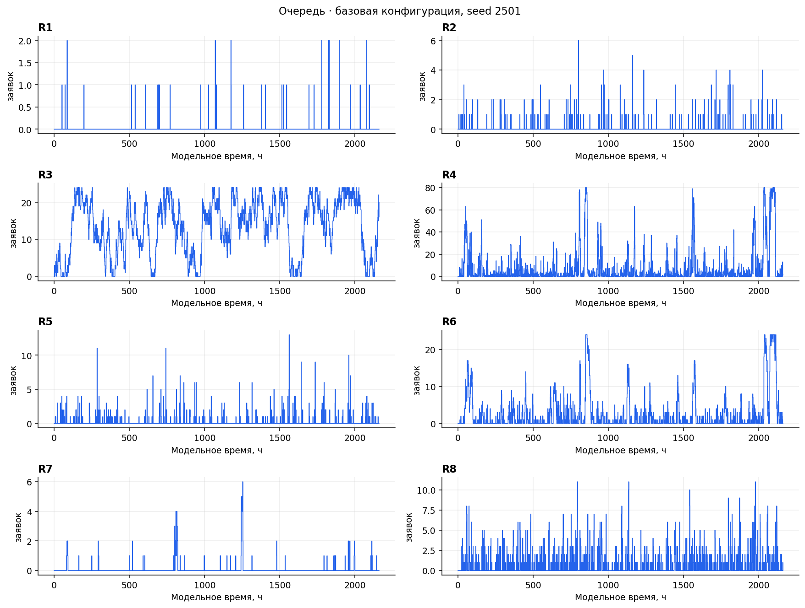

У R3 средняя загрузка 97,50%. При добавлении одного канала R3 средняя очередь изменилась на -11,93 [-12,71–-11,14] проекта, доля нарушений на -18,65 [-19,85–-17,45] п.п., выплаты на 0,07 [0,06–0,09] проекта/ч. Один новый канал R2 дал изменение выплат 0,00 [0,00–0,00] проекта/ч. Разгрузка R3 подтверждается изменением SLA и очереди.

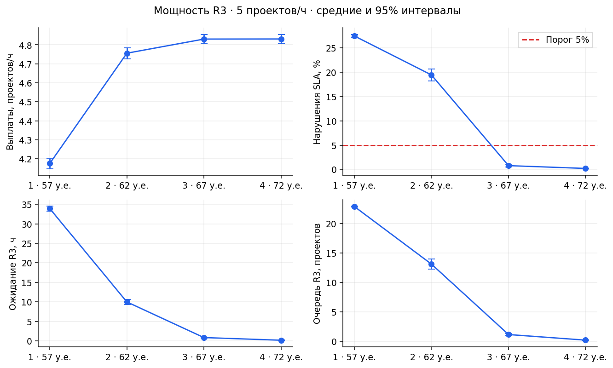

Переход с двух до трёх каналов меняет суммарный throughput на 0,081 [0,048–0,115]%. Верхняя граница ниже правила 5%. Точка по совокупным завершениям слабо отражает улучшение состава исходов, поэтому рядом оценивается рост выплат и снижение отказов. При шести проектах/ч с тремя каналами R3 получено 2,64 [1,74–3,54]% нарушений, при семи — 9,08 [7,42–10,74]%. Подтверждённый запас в проверенной конфигурации R2=2, R3=3 составляет 20% относительно базы по критерию SLA. Между 6 и 7 точная граница не оценивалась.

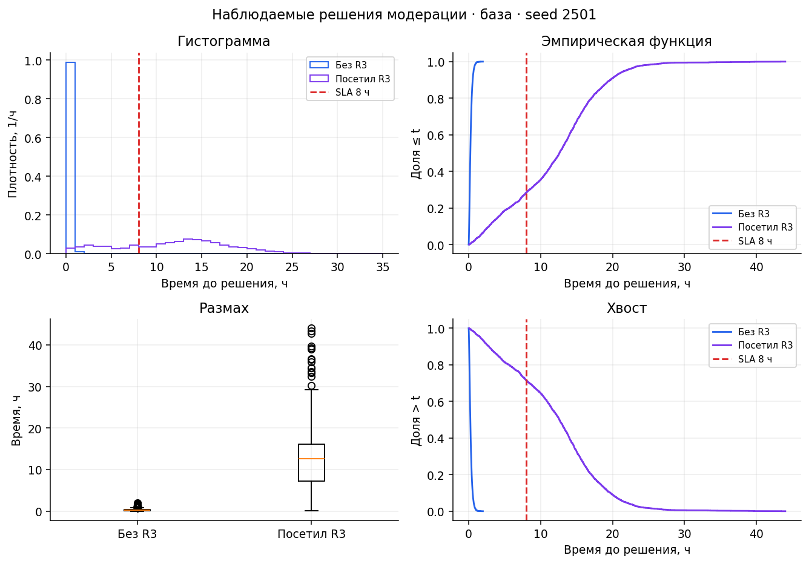

В базовом seed 2501 P95 при посещении R3 равен 21,76 ч, без R3 — 0,70 ч. Полная сегментация по категории, репутации, цели, ручной проверке, интенсивности и спору приведена в results/processed/cohort_segments.csv. Группы по фактическим маршрутам и спорам описательны, поскольку сформированы после моделируемых событий.

## 4. Управление параметрами и оптимизация

Фиксированный спрос 2,5/5/10 проекта в час и мощности R3 1/2/4 варьировались по одному фактору. Для R3 округление не потребовалось. Контролируются время, очереди, загрузка, SLA и выплаты. Факторный план 2⁴ с тремя повторами выявляет эффекты на выбранных крайних уровнях. Таблицы и код перечислены в experiments/OPTIMIZATION.md.

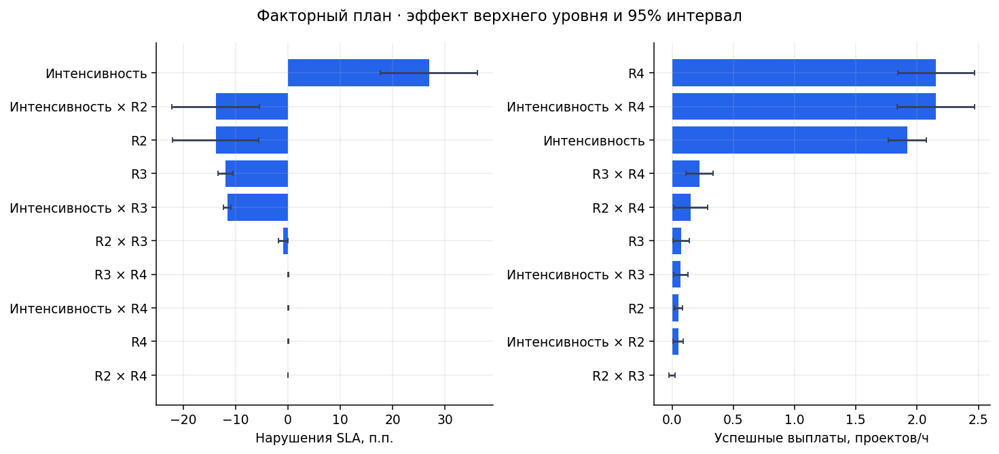

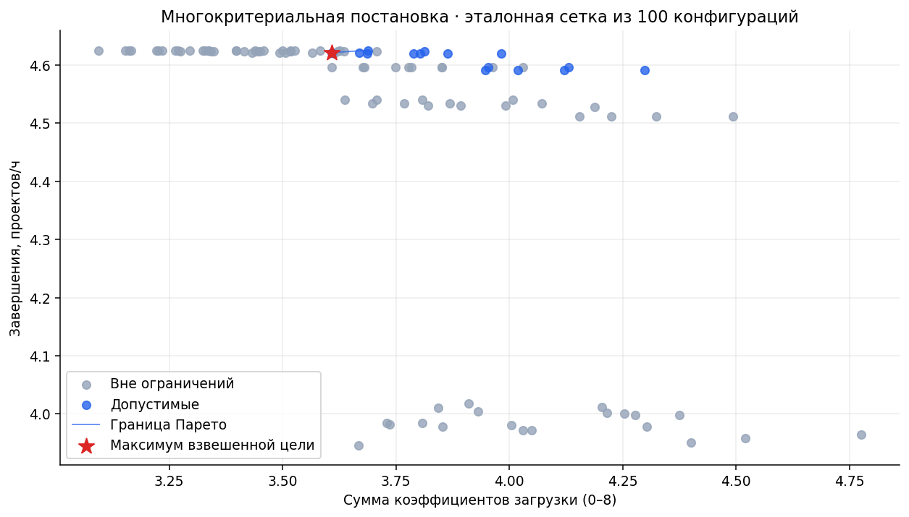

Требования поиска — SLA ≤5%, выплаты ≥4,4 проекта/ч, технические отказы ≤1%. В эталоне перебраны 100 конфигураций по три прогона на 168 ч. Три кандидата проверены на новых seeds 4701–4710 при 2160 ч. Вариант 65 у.е. подтверждает основной SLA. Платёжный SLA при пороге 0,5 ч даёт 6,93 [5,70–8,16]% нарушений. Добавление пятого канала R4 увеличивает стоимость до 68 у.е. и снижает долю нарушений платёжного SLA до 2,50 [2,45–2,56]%. Это отдельное условное решение, если организация вводит лимит нарушений и на платежи. Результаты поиска относятся к Python DES.

### 4.3. Целевая функция преподавателя

В отдельной постановке максимизируется 0,65 × throughput / 5 − 0,35 × сумма коэффициентов загрузки / 8. При тех же требованиях к SLA, выплатам и отказам введён бюджет 74 у.е. Равновзвешенная сумма восьми коэффициентов измеряет суммарную загрузку. Отдельно в таблицах сохраняется средняя загрузка, взвешенная по каналам.

На эталонной сетке оптимальная взвешенная альтернатива — R2=4, R3=3, R4=5 за 74 у.е. Независимая серия дала 4,96 [4,92–5,00] завершения/ч, сумму загрузок 3,787 [3,756–3,819] и SLA 0,63 [0,44–0,81]%. У минимального по цене варианта за 65 у.е. сумма загрузок 4,504 [4,462–4,546]. Прирост throughput мал, а снижение загрузки различимо. Нативный OptQuest использует эту же постановку.

Нативный OptQuest выполнил 100 итераций по три репликации. Лучший допустимый вариант R2/R3/R4 = 2, 3, 6 за 73 у.е. дал 4,687 завершения/ч, 4,550 выплаты/ч и 0,568% нарушений SLA. Значение цели 0,443953. Этот результат относится к 168-часовому поиску. Отдельно проверены пять положений двух нативных ползунков и 16 комбинаций Parameter Variation, по три репликации на комбинацию. На десяти новых seeds эталонной DES за 2160 ч получены SLA 0,770 [0,558–0,983]% и 4,830 [4,792–4,869] выплаты/ч.

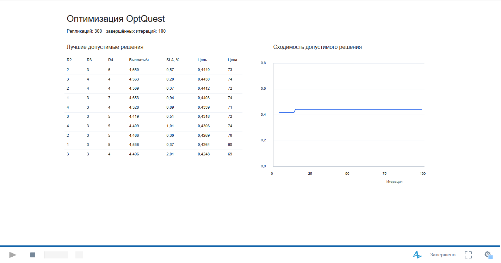

## 5. Марковская модель ручной проверки

Использованы λ = 1,3892 заявки/ч, μ = 0,6667 заявки/ч на канал, c = 2 и K = 26. λ включает попытки входа при полной системе. В графе состояний 0 ⇄ 1 ⇄ … ⇄ 26 интенсивность перехода вверх равна λ, вниз — min(n, 2)μ. На границах нет выхода за диапазон. Уравнение (4) записывается P′ = P Q, где диагональ Q равна отрицательной сумме исходящих интенсивностей. Начальное распределение сосредоточено в нуле. Стационарная проверка использует Pₙ₊₁/Pₙ = λ /(min(n+1,c)μ).

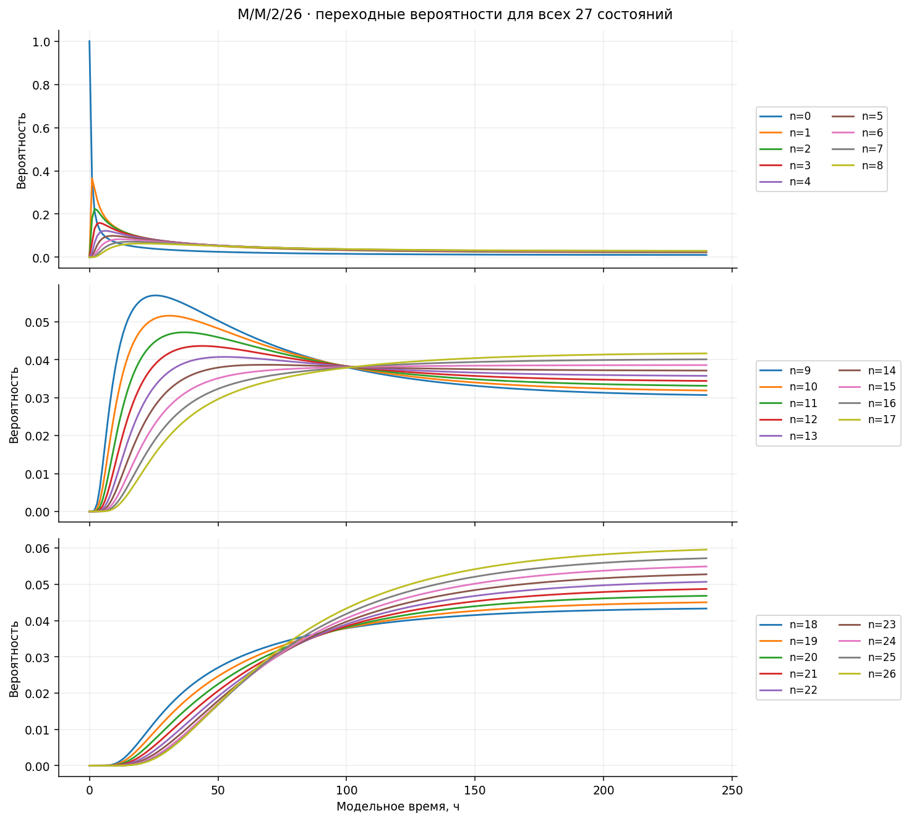

Стационарные блокировка и очередь — 6,07% и 13,64 проекта. В полной платформе на seed 2501 — 5,57% и 13,74 проекта. Согласованный DES с теми же λ, μ, c и K отдельно сопоставлен на десяти длинных прогонах. Максимальная ошибка нормировки численного решения 4.62e-14. Приближение ручной проверки одним пуассоновским входом проверено сравнением, фактические возвраты и предшествующие ресурсы в него агрегированы.

## 6. Агентная модель и гетерогенность

Агент проекта хранит состояния от поступления до выплаты или завершения. Платёж хранит собственное состояние, включая поддержку. Эталонная ABM на трёх общих seeds дала те же метрики, что DES, при эквивалентных правилах. Для тяжёлых проектов среднее обслуживание R3 умножено на 2,5. Ожидаемый средний объём работы R3 при неизменном составе входа умножается на 1 + 1,5h, где h — доля тяжёлых проектов. Приоритет лёгких применяется в очереди без прерывания начатого обслуживания.

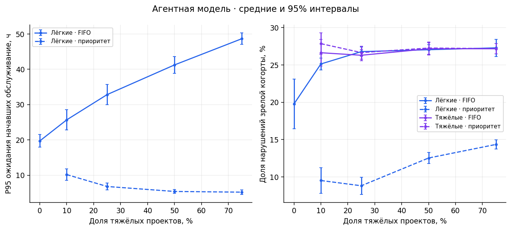

При доле 25% P95 ожидания лёгких среди начавших обслуживание — 32,85 [29,99–35,71] ч с FIFO и 6,82 [5,89–7,76] ч с приоритетом. SLA тяжёлых в этих режимах — 26,29 [25,56–27,02]% и 26,65 [25,78–27,53]%. Парная разность SLA тяжёлых при 25% равна 0,36 [0,10–0,62] п.п. Приоритет меняет распределение ожидания при том же расчётном входном объёме работы. SLA по зрелым когортам включает заявки, до обслуживания которых очередь так и не дошла.

В AnyLogic при общем seed 2501 базовые DES и ABM дали 4,952 и 4,952 завершения/ч. Средняя суммарная очередь составила 20,06 и 20,06 заявки. При добавлении тяжёлого класса в ABM P95 ожидания лёгких вырос с 19,79 до 35,89 ч. Приоритет лёгких снизил их P95 до 6,15 ч и поднял P95 тяжёлых с 38,53 до 111,42 ч. Это результаты отдельных нативных прогонов.

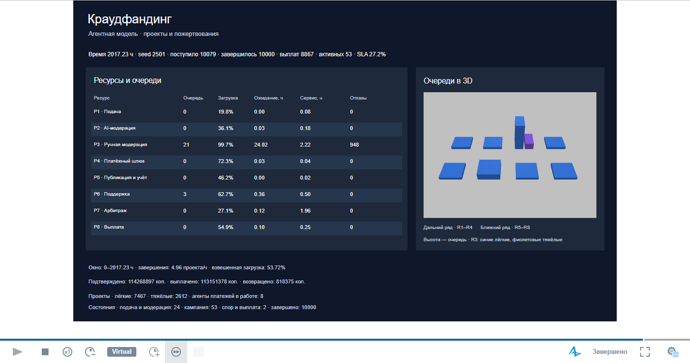

## 7. Системная динамика

Накопители — проекты на ручной обработке и в очереди, активные кампании, установленная и желаемая мощность, доверие, индекс пользователей и накопленные потоки. Мощность непрерывна и выражена в каналах R3. В уравнении (5) расход проектов R3 равен min(проекты, мощность)/1,5 ч. Доверие реагирует на поток выплат с задержкой 24 ч, индекс пользователей — 48 ч. Динамическое расширение использует сглаживание решения 8 ч и ввода мощности 16 ч. Петли R_growth и B_capacity действуют в диагностических сценариях.

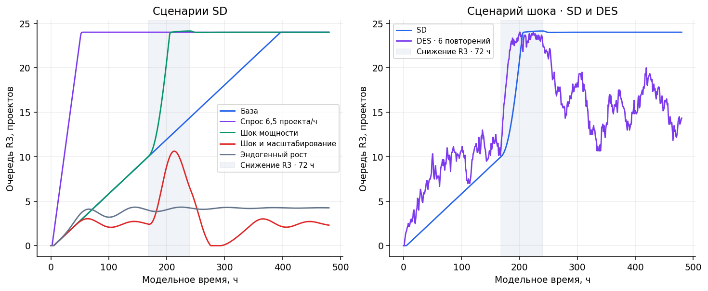

Горизонт 480 ч. Спрос повышается с 5 до 6,5 проекта/ч с часа 0. Шок снижает целевую мощность с двух каналов до одного с 168-го до 240-го часа. Через 24 ч после восстановления мощности очередь SD составляет 23,98 проекта с фиксированной политикой и 1,58 при динамической политике. DES при том же календаре физически закрывает канал сразу, SD учитывает постепенный ввод и выбытие. Согласование определяется направлением реакции и графиками, а траектории и уровень вариантов различаются. Баланс сходится с погрешностью <10⁻⁶ проекта. Уменьшение максимального шага 0,5 до 0,25 ч изменило вектор состояний не более чем на 1.75e-05 по числовой шкале его компонент.

В нативных 480-часовых прогонах AnyLogic накоплено 2246,05 выплаты в базовом сценарии, 2738,97 при повышенном спросе и 2199,24 при шоке. Все три ряда сверены с независимым численным решением и балансом проектов.

## 8. Сопоставление и решение

Таблица 1. Представления и задачи исследованных моделей.

| Показатель | DES | ABM | SD | M/M/c/K |
|---|---|---|---|---|
| Время | События | События и состояния | Непрерывное | Непрерывное вероятностное |
| Очереди | Визиты R1–R8 | Ресурс и класс | Агрегат R3 | Число заявок в R3 |
| Гетерогенность | Атрибуты и маршруты | Индивидуальные состояния и приоритет | Средние доли и коэффициенты | Однородные заявки |
| SLA и квантили | Когорты и выборочные оценки | Когорты по классам | Средние потоки | Блокировка и средняя очередь |
| Обратные связи | При включении политики | При включении взаимодействий | Доверие и расширение мощности | Фиксированные интенсивности |
| Вычисления | Рост с числом событий | Состояния и события | Интеграция 11 переменных | 27 вероятностей |
| Практическая задача | Каналы и SLA | Ущерб низкому приоритету | Восстановление после шока | Быстрая оценка одного ресурса |

Два дополняющих вывода — приоритет заметно меняет ожидание лёгких и зрелый SLA тяжёлых, а накопители показывают, что добавление мощности после шока имеет собственный лаг. DES отдельно выявляет платежи как вторичное ограничение после разгрузки модерации.

Таблица 2. Альтернативы и стресс-тест. Основные прогоны 2160 ч, стресс-тест 504 ч, 6 повторений на вариант. P95 — до наблюдаемого решения. Отказы — технические отказы проектов. Сложность внедрения оценивается качественно по числу служб и необходимости перераспределения персонала.

| Вариант | Завершения, проект/ч | P95, ч | SLA, % | Стоимость | Отказы, % | SLA при 6/ч, % | Сложность |
|---|---:|---:|---:|---:|---:|---:|---|
| База | 4,95 | 17,38 | 19,44 | 62 | 1,52 | 25,74 | Исходная |
| Добавить AI-канал | 4,95 | 17,36 | 19,25 | 64 | 1,54 | 25,75 | Низкая |
| Добавить ручной канал | 4,96 | 4,16 | 0,79 | 67 | 0,00 | 2,48 | Низкая |
| Добавить платёжный канал | 4,95 | 17,35 | 19,39 | 65 | 1,53 | 25,51 | Низкая |
| R2: 2→1, R3: 2→3 | 4,96 | 4,36 | 0,87 | 65 | 0,00 | 2,83 | Средняя |
| Перераспределить и усилить R4 | 4,93 | 4,16 | 0,70 | 68 | 0,00 | 3,16 | Средняя |

Системный анализ по Оптнеру приведён в этапах 3–9 по сравнительной таблице из учебника В. Н. Волковой и А. А. Денисова. Пункт 3 фиксирует цели и пороги. Пункт 4 связывает структуру ресурсов с дефектом R3 и миграцией к R4. Пункт 5 оценивает доступные изменения мощности, очередей и приоритетов. Пункты 6 и 7 перечисляют и оценивают пять вариантов. Пункт 8 выбирает правило и проверяет чувствительность к условиям. Пункт 9 задаёт пилот, критерии успеха и возврат к исходному расписанию.

Вариант 65 у.е. выбран по основному SLA при входе 5 проектов/ч. Если добавить условие не более 5% нарушений платёжного SLA, проверенный вариант стоит 68 у.е. При 6 проектах/ч верхняя граница SLA для 65 у.е. составила 5,18%, а у варианта с двумя каналами R2 и тремя R3 — 4,64%.

Для внедрения сначала провести пилот с R2=1, R3=3, R4=4 при сопоставимой нагрузке. Следить за зрелой долей нарушений, P95 наблюдаемых решений, нагрузкой R2, очередями R3/R4, выплатами и техническими отказами. Критерии пилота — верхняя граница интервала SLA ≤5%, технические отказы ≤1%, нижняя граница выплат ≥4,4 проекта/ч. При невыполнении пересмотреть распределение каналов. При росте нагрузки повторить испытания с вашим фактическим потоком и учесть запас каждого ресурса.

## Ограничения

Интенсивности, времена обслуживания и порог модерации 8 ч заданы для учебной платформы. Марковское приближение использует однородный стационарный поток к R3, а SD описывает усреднённые потоки и задержки. Доверительные интервалы характеризуют разброс между повторами в принятых условиях. Перед применением настройку распределений и порогов следует сверить с фактическими журналами платформы.

## Источники и воспроизведение

Исходное задание преподавателя, описание платформы и восьмиэтапное ТЗ. Карта требований сохранена в ASSIGNMENT.md. Для нумерации Оптнера использован учебник В. Н. Волковой и А. А. Денисова, «Теория систем и системный анализ», 2006. Электронная версия: https://djvu.online/file/PPG3Uguuc8h6U.

Документация AnyLogic о редакциях и ограничениях — https://www.anylogic.com/downloads/

Документация AnyLogic Engine API — https://anylogic.help/anylogic/running/engine-api.html

Сценарии и точные команды находятся в README.md. Отдельные материалы по этапам собраны в каталоге stages. Первичные измерения хранятся в results/raw. Обработанные таблицы — в results/processed. Графики воспроизводятся через analysis/capacity_results.py и analysis/compare_results.py. Сведения о статусе ALP, нативных экспериментов, 3D и библиотек собраны в STATUS.md.

## Приложение. Приёмочные материалы

В REQUIREMENTS.md указано, каким артефактом и проверкой подтверждён каждый пункт задания. В results/native хранятся журналы и ряды, полученные в AnyLogic. Файлы моделей и способ запуска каждого эксперимента перечислены в models/README.md. План выступления и двадцать ответов подготовлены в report/DEFENSE.md.

| Что проверить в AnyLogic | Контрольный признак | Путь к результатам |
|---|---|---|
| DES, основной прогон | 10 000 завершений и 9590 выплат при seed 2501. Сходятся проектный баланс и учёт копеек. | results/native/research/ |
| DES, правила остановки | Счётчик срабатывает на двух терминальных исходах. В отдельной проверке срабатывает горизонт 2160 ч. | results/native/count/ и results/native/horizon-diagnostic/ |
| Variation и OptQuest | 48 результатов Variation и 300 результатов OptQuest. Конфигурации и seeds доступны для сверки. | results/native/experiments/ |
| Markov, ручная очередь | 27 вероятностей в 241 точке и три оценки ёмкости. | results/native/markov/ |
| ABM, сравнение классов | Базовые агрегаты совпадают с DES. Групповые P95 меняются при вводе тяжёлых и приоритета. | results/processed/abm_native.csv |
| SD, три сценария | По 481 точке до 480-го часа. Моделируемый шок длится с 168-го до 240-го часа. | results/native/sd-base/, sd-demand/ и sd-shock/ |
