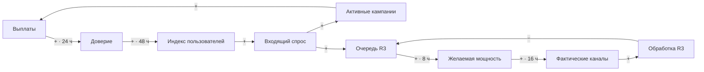

# Этап 7. Системная динамика

[Модель PlatformDynamics.alp](../models/sd/PlatformDynamics.alp) описывает накопители нагрузки R3, активных кампаний, фактической и желаемой мощности, доверия, индекса пользователей и накопленных потоков. В каждом уравнении производная накопителя равна входящим потокам за вычетом исходящих. Баланс проектов проверяется как разность поступлений и суммы обработки R3, активных кампаний, выплат и прочих выходов.

- Усиливающая петля. Выплаты повышают доверие с задержкой 24 ч. Доверие повышает индекс пользователей с задержкой 48 ч. Индекс увеличивает спрос.
- Балансирующая петля. Очередь увеличивает требуемую мощность. Решение адаптируется за 8 ч, фактическая мощность — за 16 ч. Рост мощности ускоряет обработку и уменьшает очередь. После шока к снижению очереди система приходит с запаздыванием.
- В базовом сценарии действуют 5 проектов/ч и два канала. Сценарий спроса оценивает 6,5 проекта/ч. Шок на интервале 168–240 ч сокращает целевую мощность до одного канала. Дополнительные сценарии исследуют задержанное масштабирование и эндогенный рост.



| Сценарий за 480 ч | Поступило | Выплачено | Максимум очереди |
|---|---:|---:|---:|
| База | 2400,00 | 2246,05 | 24,00 |
| Спрос 6,5/ч | 3120,00 | 2738,97 | 24,00 |
| Шок мощности | 2400,00 | 2199,24 | 24,14 |
| Шок с адаптацией | 2400,00 | 2271,13 | 10,63 |
| Эндогенный рост | 2724,56 | 2574,45 | 4,33 |

База и повышенная нагрузка насыщают ограниченную очередь. Во время шока доминирует внешний провал мощности. При адаптации через 24 ч после восстановления очередь равна 1,58 проекта, при фиксированной мощности — 23,98. На ранней фазе эндогенного сценария рост усиливают доверие и приток пользователей, позднее влияние роста ограничивает реакция мощности. Задержка даёт переходный провал и перерегулирование. При адаптации фактическая мощность в момент начала шока составляет 2,12 канала. Через 24 ч она опускается до 1,63, к восстановлению вырастает до 2,36 и через 12 ч достигает 2,41. Очередь при этом поднимается до 10,63 и временно опускается до нуля после восстановления. Мощность приходит к 2,11 канала на 480-м часу. В проверенных сценариях устойчивых периодических колебаний не выявлено.

DES даёт сходные качественные тренды накопления и насыщения. DES меняет доступность дискретного канала непосредственно, тогда как мощности SD меняются плавно. SLA и P95 требуют индивидуальных сроков DES. SD позволяет исследовать устойчивость политик ввода мощности и изменение спроса. [Траектории](../figures/sd.png), [сравнение с DES](../results/raw/sd_des_comparison.csv), [баланс и шаг](../results/processed/sd_checks.csv)

В каждом из трёх прогонов AnyLogic получено по 481 точке на горизонте 480 ч. Проверены неотрицательность накопителей, баланс и расхождения с независимым численным решением. Серая область на графике охватывает 168–240-й часы шока.

| Сценарий AnyLogic | Выплаты | Максимум очереди R3 | Максимум ошибки баланса, проектов |
|---|---:|---:|---:|
| База | 2 246,05 | 24,00 | 3,22 × 10⁻⁸ |
| Повышенный спрос | 2 738,97 | 24,00 | 1,12 × 10⁻⁸ |
| Шок мощности | 2 199,24 | 24,14 | 2,72 × 10⁻⁸ |

[Экран модели](../figures/native_sd.png) · [Нативные траектории](../figures/sd_native.png) · [База](../results/native/sd-base/series.csv) · [Спрос](../results/native/sd-demand/series.csv) · [Шок](../results/native/sd-shock/series.csv)

```powershell
.\experiments\launch_anylogic.ps1 -Task SD-Base
.\experiments\launch_anylogic.ps1 -Task SD-Demand
.\experiments\launch_anylogic.ps1 -Task SD-Shock
python experiments/accept_continuous.py sd --scenario 0 --source .local/run-sd-base/temp
python experiments/accept_continuous.py sd --scenario 1 --source .local/run-sd-demand/temp
python experiments/accept_continuous.py sd --scenario 2 --source .local/run-sd-shock/temp
python experiments/accept_continuous.py sd-plot
```
